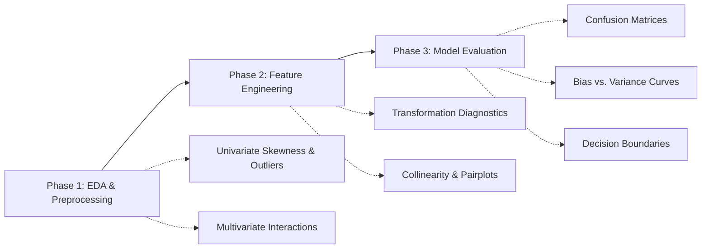

# 🎓 AltSchool Africa: Data Science Portfolio — Third Semester
### 🚀 Baraka 2026 Cohort | Machine Learning Workflows & Applied Analytics

[](https://www.python.org/)
[](https://jupyter.org/)
[](https://pandas.pydata.org/)
[](https://seaborn.pydata.org/)
[](https://altschoolafrica.com/)
[](https://github.com/iPablo26)

**Portfolio Author:** [Peter "Pablo" Okwukogu](https://github.com/iPablo26)  
**Program:** AltSchool Africa School of Data & Artificial Intelligence  
**Track:** Data Science (Semester 3: Machine Learning Specialization)

---

> [!IMPORTANT]
> ### ⚠️ Educational Use Disclaimer & Caveat
> The dataset utilized in this repository (`us_education_system_dataset.csv`) is synthetically modeled and curated **strictly for educational, instructional, and statistical learning purposes**.
> 
> It is **NOT** an authentic reflection, official census data, or governmental report of the real-world United States Educational System, specific school districts, or actual operating institutions. All analyses and conclusions drawn within these exercises serve purely to demonstrate data science, machine learning visualization, and statistical modeling workflows.

---

## 📌 Executive Summary

Welcome to my central portfolio repository for the **Third Semester of the AltSchool Africa Data Science Program (Baraka 2026 Cohort)**. 

The focus of this semester is the complete **Machine Learning Lifecycle**: transitioning from descriptive statistics to predictive modeling, rigorous exploratory data analysis (EDA), diagnostic visualization, feature engineering, and production-ready machine learning pipelines.

This repository tracks live interactive lecture labs, assignments, independent exploratory analyses, and applied machine learning models.

---

## 📂 Repository Structure

```text
Third-Semester-Baraka-2026---Data-Science/
├── .gitignore                                           # Clean Git ignore rules (OS, IDE, checkpoints)
├── First Live Session Introduction to Visualization...   # Live Session 1: ML Visualization Pipeline & EDA
├── README.md                                            # Comprehensive portfolio documentation
├── requirements.txt                                     # Reproducible Python dependencies
├── us_education_system_data_dictionary.md               # 35-variable metadata schema & documentation
└── us_education_system_dataset.csv                      # Modeled dataset (5,000 records × 35 features)
```

---

## 🧭 Activities & Curriculum Tracker

| Session / Milestone | Module Focus | Core Deliverables / Artifacts | Status |
| :--- | :--- | :--- | :---: |
| **Live Session 01** | **Introduction to Visualization for ML** | Univariate, Bivariate & Multivariate EDA on institutional data | ✅ Completed |
| **Module 02** *(Upcoming)* | **Feature Engineering & Preprocessing** | Scaling, encoding, outlier strategies & handling missingness | ⏳ Scheduled |
| **Module 03** *(Upcoming)* | **Supervised Learning: Regression** | Academic outcome prediction (`graduation_rate_pct`) | ⏳ Scheduled |
| **Module 04** *(Upcoming)* | **Supervised Learning: Classification** | Title I & school performance classification models | ⏳ Scheduled |
| **Module 05** *(Upcoming)* | **Model Evaluation & Diagnostics** | ROC-AUC, Confusion Matrices, Bias vs. Variance tradeoff | ⏳ Scheduled |

---

## 🔬 Activity Spotlight: Live Session 1 — Visualization for ML

The foundational session established that **data visualization is not merely about aesthetic charting—it is a computational and intuitive instrument essential to every stage of the machine learning lifecycle.**

### The 3-Phase ML Visualization Paradigm



### Applied Exploratory Analysis Highlights

Working with the 5,000-institution dataset, the initial investigation evaluated key structural, socioeconomic, and academic metrics:

#### 1. Univariate Distribution & Skewness Analysis
- **Per-Pupil Expenditure (`per_pupil_expenditure_usd`):** 
  - Explored operational expenditure distributions across American schools.
  - The expenditure displays a moderately right-skewed profile (Mean: ~$17,113/pupil, Median: ~$16,830, IQR: $14,471–$19,228), with distinct high-end outliers exceeding $40,000–$50,000/pupil.
- **Academic Performance Across Federal Title I Status:**
  - Evaluated Math Proficiency distributions (`math_proficiency_pct`) stratified by Title I eligibility tiers (`Title I Schoolwide`, `Title I Targeted`, `Not Title I Eligible`).
  - Identified pronounced distribution shifts reflecting socioeconomic and resource allocation disparities.

#### 2. Bivariate & Multivariate Interaction Modeling
- **Socioeconomic Impact vs. Math Proficiency:**
  - Evaluated the interaction between the percentage of Free/Reduced-Price Lunch recipients (`percent_free_reduced_lunch`—a primary SES proxy) and standardized Math Proficiency (`math_proficiency_pct`).
  - **Faceted Mappings:** Mapped institutional control/governance (`control`: Public, Charter, Private) to marker color and Per-Pupil Spending (`per_pupil_expenditure_usd`) to marker size.
  - **Key ML Insight:** Observed an inverse relationship between socioeconomic disadvantage and standardized math scores, while highlighting non-linear variances across private and public charter alternatives.

---

## 📊 Dataset & Schema Overview

The primary dataset modeled in this repository encapsulates **5,000 educational institutions** across all 50 US states and Washington D.C., encompassing **35 analytical dimensions**.

| Category | Representative Variables | Analytical Significance |
| :--- | :--- | :--- |
| **Institutional Context** | `institution_id`, `state_code`, `nces_locale`, `level`, `control`, `title_i_status` | Geographic distribution, school grade tier, governance |
| **Resources & Staffing** | `total_enrollment`, `number_of_teachers`, `student_teacher_ratio`, `per_pupil_expenditure_usd` | Capacity, teacher density, institutional funding intensity |
| **Socioeconomic & Demographics** | `percent_free_reduced_lunch`, `racial_*_pct`, `special_education_pct`, `english_learner_pct` | Student body composition, language assistance, SES index |
| **Financial Allocations** | `federal_funding_pct`, `state_funding_pct`, `local_funding_pct` | Fiscal mechanics (local property taxes vs. state/federal aid) |
| **Academic Outcomes** | `math_proficiency_pct`, `reading_proficiency_pct`, `graduation_rate_pct`, `avg_sat_score`, `avg_act_score` | Core target variables for predictive and diagnostic ML modeling |

> 📖 *For complete field descriptions, allowable ranges, and data types, refer to the full [Data Dictionary Documentation](us_education_system_data_dictionary.md).*

---

## 🛠️ Tech Stack & Environment

- **Core Language:** Python 3.10+
- **Environment:** Jupyter Notebook / Google Colab / VS Code
- **Data Manipulation:** `pandas`, `numpy`
- **Statistical Visualization:** `matplotlib`, `seaborn`
- **Version Control:** Git & GitHub

---

## 🚀 Getting Started Locally

### 1. Clone the Repository
```bash
git clone https://github.com/iPablo26/Third-Semester-Baraka-2026---Data-Science.git
cd Third-Semester-Baraka-2026---Data-Science
```

### 2. Set Up a Virtual Environment
```bash
# macOS / Linux
python3 -m venv .venv
source .venv/bin/activate

# Windows
python -m venv .venv
.venv\Scripts\activate
```

### 3. Install Dependencies
```bash
pip install --upgrade pip
pip install -r requirements.txt
```

### 4. Launch Jupyter Notebook
```bash
jupyter notebook
```
Open [`First Live Session Introduction to Visualization for ML.ipynb`](First%20Live%20Session%20Introduction%20to%20Visualization%20for%20ML.ipynb) to inspect the data exploration and visualizations.

---

## 👤 Author & Connect

**Peter "Pablo" Okwukogu**  
- GitHub: [@iPablo26](https://github.com/iPablo26)  
- Focus: Data Science, Machine Learning, Cloud Architecture & AI Engineering  
- Cohort: AltSchool Africa Data Science — Baraka 2026  

---

## 📄 License & Attribution

This project is licensed under the MIT License — see the repository for details. Created as part of the AltSchool Africa 2026 learning curriculum.
