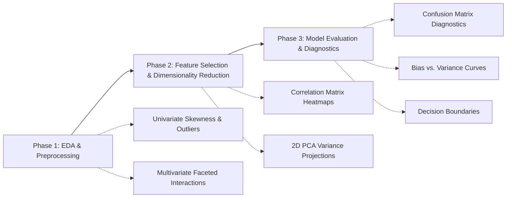
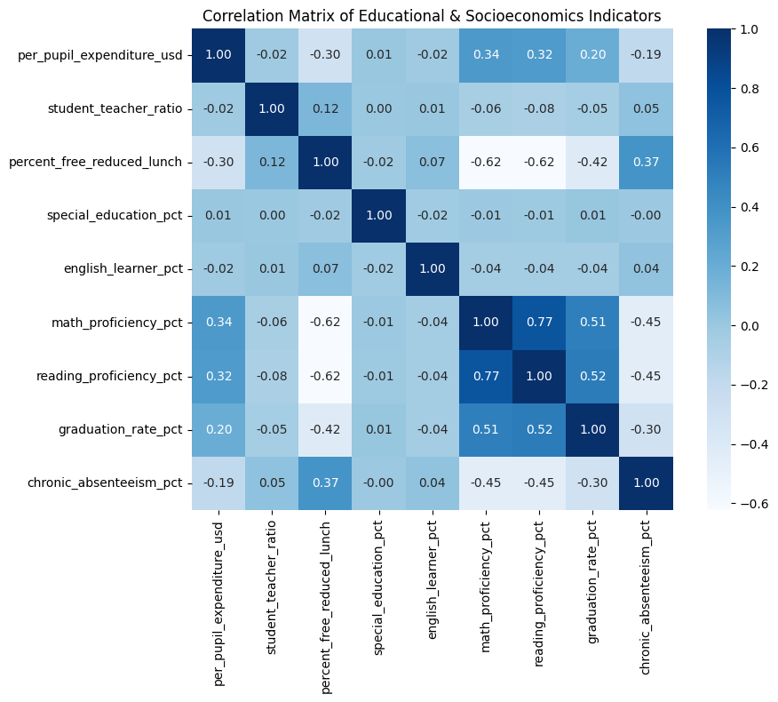

# 🎓 AltSchool Africa: Data Science Portfolio — Third Semester
### 🚀 Baraka 2026 Cohort | Machine Learning Workflows & Applied Analytics

[](https://www.python.org/)
[](https://jupyter.org/)
[](https://pandas.pydata.org/)
[](https://scikit-learn.org/)
[](https://seaborn.pydata.org/)
[](https://altschoolafrica.com/)
[](https://github.com/iPablo26)

**Portfolio Author:** [Peter "Pablo" Okwukogu](https://github.com/iPablo26)  
**Program:** AltSchool Africa School of Data & Artificial Intelligence  
**Track:** Data Science (Semester 3: Machine Learning Specialization)

---

> [!IMPORTANT]
> ### ⚠️ Educational Use Disclaimer & Caveat
> The dataset utilized in this repository (`us_education_system_dataset.csv`) is synthetically modeled and curated **strictly for educational, instructional, and statistical learning purposes**.
> 
> It is **NOT** an authentic reflection, official census data, or governmental report of the real-world United States Educational System, specific school districts, or actual operating institutions. All analyses and conclusions drawn within these exercises serve purely to demonstrate data science, machine learning visualization, and statistical modeling workflows.

---

## 📌 Executive Summary

Welcome to my central portfolio repository for the **Third Semester of the AltSchool Africa Data Science Program (Baraka 2026 Cohort)**. 

The focus of this semester is the complete **Machine Learning Lifecycle**: transitioning from descriptive statistics to predictive modeling, rigorous exploratory data analysis (EDA), diagnostic visualization, dimensionality reduction, feature engineering, and production-ready machine learning pipelines.

This repository tracks live interactive lecture labs, assignments, independent exploratory analyses, and applied machine learning models.

---

## 📂 Repository Structure

```text
Third-Semester-Baraka-2026---Data-Science/
├── .gitignore                                                                 # Clean Git ignore rules (OS, IDE, checkpoints)
├── 2D PCA Projection.png                                                      # Exported 2D PCA projection visual artifact
├── Confusion Matrix.png                                                       # Exported Random Forest Confusion Matrix heatmap
├── corr_matrix.png                                                            # Exported 9-feature Correlation Matrix heatmap
├── First Live Session Introduction to Visualization for ML.ipynb              # Live Session 1 (Part 1): Univariate & Multivariate EDA
├── First Live Session Introduction to Visualization for ML - Continuation.ipynb # Live Session 1 (Part 2): Correlation, Random Forest & PCA
├── README.md                                                                  # Comprehensive portfolio documentation
├── requirements.txt                                                           # Reproducible Python dependencies
├── us_education_system_data_dictionary.md                                     # 35-variable metadata schema & documentation
└── us_education_system_dataset.csv                                            # Modeled dataset (5,000 records × 35 features)
```

---

## 🧭 Activities & Curriculum Tracker

| Session / Milestone | Module Focus | Core Deliverables / Artifacts | Status |
| :--- | :--- | :--- | :---: |
| **Live Session 01 (Part 1)** | **Introduction to Visualization for ML** | Univariate, Bivariate & Multivariate EDA on institutional data | ✅ Completed |
| **Live Session 01 (Part 2)** | **ML Visualization Continuation: Diagnostics & Dimensionality Reduction** | Correlation Matrix, Random Forest Classification (`Confusion Matrix.png`), & 2D PCA Embeddings (`2D PCA Projection.png`) | ✅ Completed |
| **Module 02** *(Upcoming)* | **Feature Engineering & Preprocessing** | Scaling, encoding, outlier strategies & handling missingness | ⏳ Scheduled |
| **Module 03** *(Upcoming)* | **Supervised Learning: Regression** | Academic outcome prediction (`graduation_rate_pct`) | ⏳ Scheduled |
| **Module 04** *(Upcoming)* | **Supervised Learning: Classification** | Title I & school performance classification models | ⏳ Scheduled |
| **Module 05** *(Upcoming)* | **Model Evaluation & Diagnostics** | ROC-AUC, Precision-Recall, Bias vs. Variance tradeoff | ⏳ Scheduled |

---

## 🔬 Activity Spotlight: Visualization Across the ML Lifecycle

The foundational live sessions establish that **data visualization is not merely about aesthetic charting—it is a computational and diagnostic instrument essential to every stage of the machine learning workflow.**

### The 3-Phase ML Visualization Paradigm



---

### Part 1: Exploratory Data Analysis (Univariate & Multivariate Interactions)
*Notebook:* [`First Live Session Introduction to Visualization for ML.ipynb`](First%20Live%20Session%20Introduction%20to%20Visualization%20for%20ML.ipynb)

1. **Univariate Distribution & Skewness Analysis:**
   - **Per-Pupil Expenditure (`per_pupil_expenditure_usd`):** Displays a moderately right-skewed distribution (Mean: ~$17,113/pupil, Median: ~$16,830, IQR: $14,471–$19,228), with high-end funding outliers reaching $40,000–$50,000/pupil.
   - **Math Proficiency by Federal Title I Status:** Boxplot stratification across `Title I Schoolwide`, `Title I Targeted`, and `Not Title I Eligible` schools highlights structural performance shifts tied to socioeconomic funding tiers.
2. **Bivariate & Multivariate Interaction Modeling:**
   - Mapped `percent_free_reduced_lunch` (X-axis) against `math_proficiency_pct` (Y-axis), encoding governance `control` (Public, Charter, Private) as color and `per_pupil_expenditure_usd` as bubble size.
   - Revealed a strong inverse relationship between student poverty and math proficiency across all governance types.

---

### Part 2: Feature Selection, Classification Diagnostics & Dimensionality Reduction
*Notebook:* [`First Live Session Introduction to Visualization for ML - Continuation.ipynb`](First%20Live%20Session%20Introduction%20to%20Visualization%20for%20ML%20-%20Continuation.ipynb)

#### 1. Correlation Matrix of Educational & Socioeconomic Indicators


**Key Analytical Findings & ML Workflow Implications:**
- **Academic Outcomes Move Together (Multicollinearity Alert):**
  - `math_proficiency_pct` and `reading_proficiency_pct` exhibit the strongest positive relationship (`r = +0.77`), and both correlate strongly with `graduation_rate_pct` (`+0.51` and `+0.52`).
  - *Workflow Implication:* Including both Math and Reading Proficiency as predictors in linear models introduces redundancy (collinearity). Combining them into a composite academic index or selecting one prevents unstable feature weights.
- **Socioeconomic Hardship is the Dominant Underlying Driver (`percent_free_reduced_lunch`):**
  - Strongest negative correlation with both Math and Reading proficiency (`r = -0.62`) and Graduation Rate (`r = -0.42`), alongside a positive link with `chronic_absenteeism_pct` (`r = +0.37`) and a negative link with `per_pupil_expenditure_usd` (`r = -0.30`).
- **Attendance & Funding Levers:**
  - `chronic_absenteeism_pct` negatively impacts proficiency (`-0.45`) and graduation (`-0.30`), acting as an actionable intervention target.
  - `per_pupil_expenditure_usd` shows moderate positive correlations with Math (`+0.34`), Reading (`+0.32`), and Graduation (`+0.20`), though partially confounded by local socioeconomic wealth.
- **Non-Linear / Independent Demographic Features (`r ≈ 0.00`):**
  - `student_teacher_ratio` (`-0.08` to `+0.12`), `special_education_pct` (`-0.02` to `+0.01`), and `english_learner_pct` (`-0.04` to `+0.07`) show near-zero linear correlation with school-wide academic performance—confirming that lower school-wide test scores are not driven by Special Education or English Learner enrollment shares.

---

#### 2. Model Diagnostic: Random Forest Confusion Matrix Heatmap
To evaluate how well institutional and socioeconomic indicators predict academic standing, a **Random Forest Classifier** (`n_estimators=100`, 70/30 train-test split on `5,000` cleaned records = `1,500` test schools) was trained to classify schools into **Below Median (`0`)** vs. **Above Median (`1`)** Math Proficiency (`math_proficiency_pct`).


| Quadrant | True Label | Predicted Label | Count | Diagnostic Meaning |
| :--- | :--- | :--- | :---: | :--- |
| **Top-Left** *(True Negative)* | Below Median | Below Median | **595** | Correctly identified struggling/below-median schools (**81.4% Recall** for Below Median). |
| **Bottom-Right** *(True Positive)* | Above Median | Above Median | **590** | Correctly identified high-performing/above-median schools (**76.7% Recall** for Above Median). |
| **Top-Right** *(False Positive)* | Below Median | Above Median | **136** | *Over-Optimistic Error:* Struggling schools misclassified as Above Median (risk of missing needed intervention). |
| **Bottom-Left** *(False Negative)* | Above Median | Below Median | **179** | *Conservative False Alarm:* Above-median schools flagged as Below Median (safer error in resource allocation). |

**Key Diagnostic Insights:**
- **79.0% Overall Test Accuracy (`1,185 / 1,500` correct):** Strong out-of-sample predictive accuracy across a balanced test set (`731` actual Below Median vs. `769` actual Above Median).
- **Favorable Error Asymmetry for Policy Intervention:** The model makes fewer high-risk misses (`136` struggling schools overlooked) than conservative false alarms (`179` borderline schools flagged for support).

---

#### 3. Dimensionality Reduction: 2D PCA Projection
Using `StandardScaler` and **Principal Component Analysis (`PCA(n_components=2)`)**, the 8 standardized predictor variables were projected onto a 2D plane to inspect class separability and latent structure.


**Key Analytical Findings & Workflow Implications:**
- **44.7% Total Variance Captured in 2D (`31.9%` on PC1 + `12.8%` on PC2):**
  - Nearly half of the multidimensional variance across all institutional features is preserved in just two orthogonal axes, while `55.3%` resides in higher-order dimensions.
- **PC1 (`31.9% Variance`) Represents the Socioeconomic & Academic Readiness Axis:**
  - Class separation occurs almost entirely from **left to right** along Principal Component 1: **Low Tier (`0`, green)** schools cluster on the left (`PC1 < 0`), while **High Tier (`1`, orange)** schools cluster on the right (`PC1 > 0`).
- **PC2 (`12.8% Variance`) Captures Non-Performance Structural Variation:**
  - Both green and orange clouds span the exact same vertical range (`-4` to `+3.5`), showing that PC2 captures institutional differences (such as staffing ratios and demographic composition) that are independent of performance tier.
- **Visualizing the Confusion Matrix Overlap (The "Fuzzy Middle"):**
  - Rather than forming two disconnected islands, schools lie along a continuous oval spectrum. The central overlap zone (`-1.5 ≤ PC1 ≤ +1.5`) visually explains why the Random Forest model incurred `315` misclassifications on borderline institutions near the 50th percentile cutoff.
  - **Outlier Discovery:** Orange points deep in the left-hand green region (`PC1 ≈ -2.5`) represent *"Beat-the-Odds"* institutions achieving above-median proficiency despite severe socioeconomic headwinds.

---

## 📊 Dataset & Schema Overview

The primary dataset modeled in this repository encapsulates **5,000 educational institutions** across all 50 US states and Washington D.C., encompassing **35 analytical dimensions**.

| Category | Representative Variables | Analytical Significance |
| :--- | :--- | :--- |
| **Institutional Context** | `institution_id`, `state_code`, `nces_locale`, `level`, `control`, `title_i_status` | Geographic distribution, school grade tier, governance |
| **Resources & Staffing** | `total_enrollment`, `number_of_teachers`, `student_teacher_ratio`, `per_pupil_expenditure_usd` | Capacity, teacher density, institutional funding intensity |
| **Socioeconomic & Demographics** | `percent_free_reduced_lunch`, `racial_*_pct`, `special_education_pct`, `english_learner_pct` | Student body composition, language assistance, SES index |
| **Financial Allocations** | `federal_funding_pct`, `state_funding_pct`, `local_funding_pct` | Fiscal mechanics (local property taxes vs. state/federal aid) |
| **Academic Outcomes** | `math_proficiency_pct`, `reading_proficiency_pct`, `graduation_rate_pct`, `avg_sat_score`, `avg_act_score` | Core target variables for predictive and diagnostic ML modeling |

> 📖 *For complete field descriptions, allowable ranges, and data types, refer to the full [Data Dictionary Documentation](us_education_system_data_dictionary.md).*

---

## 🛠️ Tech Stack & Environment

- **Core Language:** Python 3.10+
- **Environment:** Jupyter Notebook / Google Colab / VS Code
- **Data Manipulation:** `pandas`, `numpy`, `scipy`
- **Machine Learning & Dimensionality Reduction:** `scikit-learn` (`RandomForestClassifier`, `PCA`, `StandardScaler`, `confusion_matrix`)
- **Statistical Visualization:** `matplotlib`, `seaborn`
- **Version Control:** Git & GitHub

---

## 🚀 Getting Started Locally

### 1. Clone the Repository
```bash
git clone https://github.com/iPablo26/Third-Semester-Baraka-2026---Data-Science.git
cd Third-Semester-Baraka-2026---Data-Science
```

### 2. Set Up a Virtual Environment
```bash
# macOS / Linux
python3 -m venv .venv
source .venv/bin/activate

# Windows
python -m venv .venv
.venv\Scripts\activate
```

### 3. Install Dependencies
```bash
pip install --upgrade pip
pip install -r requirements.txt
```

### 4. Launch Jupyter Notebook
```bash
jupyter notebook
```
Open either notebook to explore the workflows:
- [`First Live Session Introduction to Visualization for ML.ipynb`](First%20Live%20Session%20Introduction%20to%20Visualization%20for%20ML.ipynb) — *Part 1: Univariate, Bivariate & Multivariate EDA*
- [`First Live Session Introduction to Visualization for ML - Continuation.ipynb`](First%20Live%20Session%20Introduction%20to%20Visualization%20for%20ML%20-%20Continuation.ipynb) — *Part 2: Correlation Matrices, Random Forest Diagnostics & 2D PCA Projections*

---

## 👤 Author & Connect

**Peter "Pablo" Okwukogu**  
- GitHub: [@iPablo26](https://github.com/iPablo26)  
- Focus: Data Science, Machine Learning, Cloud Architecture & AI Engineering  
- Cohort: AltSchool Africa Data Science — Baraka 2026  

---

## 📄 License & Attribution

This project is licensed under the MIT License — see the repository for details. Created as part of the AltSchool Africa 2026 learning curriculum.
